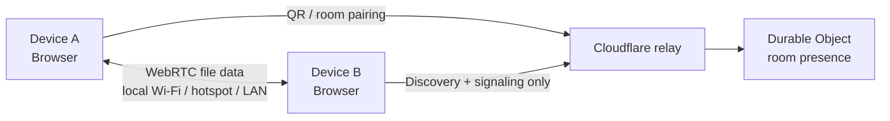

# AirLocal

<p align="center">
  <strong>Local file sharing from the browser.</strong><br />
  Transfer files between nearby devices without an account or native app.
</p>

<p align="center">
  <a href="https://github.com/pulkitpareek18/AirLocal">
    
  </a>
  <a href="https://github.com/pulkitpareek18/AirLocal/network/members">
    
  </a>
  <a href="https://github.com/pulkitpareek18/AirLocal/issues">
    
  </a>
  <a href="https://github.com/pulkitpareek18/AirLocal/commits/main">
    
  </a>
  <a href="https://github.com/pulkitpareek18/AirLocal">
    
  </a>
</p>

<p align="center">
  <a href="#quick-start">Quick start</a> ·
  <a href="#how-it-works">How it works</a> ·
  <a href="#privacy-and-security">Privacy</a> ·
  <a href="#deployment">Deployment</a> ·
  <a href="#contributing">Contributing</a>
</p>

## Overview

AirLocal is a browser application for transferring files between nearby
devices. Open it on both devices, pair with a QR code or four-digit room code,
and transfer files through a direct browser connection.

Both devices should use the **same local network**: shared Wi-Fi, a phone
hotspot, or LAN/Ethernet. File bytes stay on that local connection and do not
use internet data or pass through a server.

### Highlights

- **No account required** — open the site and start pairing.
- **QR and room-code pairing** — scan or enter the same four-digit code.
- **Direct browser transfers** — WebRTC DataChannels carry file data between
  browsers.
- **Progress and transfer telemetry** — progress, speed, and estimated time
  remaining are shown during transfers.
- **Transfer controls** — chunked streaming, backpressure, queues,
  cancellation, and receiver-side cleanup.
- **Flexible save destinations** — browser Downloads fallback or a selected
  folder through the File System Access API.
- **Backup mode** — create timestamped session folders after folder permission
  has been granted.
- **Conflict handling** — Replace, Keep both, Skip, and Replace all.
- **Frontend stack** — Vite, React, TypeScript, Tailwind CSS, and local
  shadcn-style UI primitives.

## Preview



The relay coordinates discovery and signaling. It does **not** receive, store,
or inspect file contents.

## How it works

1. Open AirLocal on both devices.
2. Put both devices on the same local network: shared Wi-Fi, a phone hotspot,
   or LAN/Ethernet.
3. Pair by scanning the QR code or entering the same four-digit room code.
4. Accept the connection request when prompted.
5. Choose files and send them directly to the other browser.

The room relay exchanges only the messages needed for presence and WebRTC
negotiation. Once the direct browser connection is established, file data uses
the local network. Discovery may still work across different networks, but
transfer availability and routing depend on browser and network conditions.

## Architecture

| Layer | Technology | Responsibility |
| --- | --- | --- |
| Frontend | Vite, React, TypeScript | Static application UI and transfer engine |
| Styling | Tailwind CSS, local shadcn-style primitives | Accessible, responsive interface |
| Hosting | Vercel static deployment | Serves the compiled frontend |
| Discovery relay | Cloudflare Worker + Durable Object | Room presence and signaling |
| Direct transfer | WebRTC DataChannels | File bytes between browsers |
| Temporary staging | Origin Private File System (OPFS) | Disk-backed receive staging |
| Save preferences | IndexedDB + File System Access API | Persist selected folder handles where supported |

## Privacy and security

- File bytes do not pass through Vercel or the Cloudflare relay.
- WebRTC DataChannels provide the browser connection used for transfer.
- The relay handles room presence, signaling, and limited transfer-control
  messages only.
- The same-network workflow keeps file traffic on the local Wi-Fi, hotspot, or
  LAN/Ethernet connection rather than your internet connection.
- Room codes are discovery identifiers, not passwords. Anyone who knows a room
  code may see devices in that room, so use a fresh code for sensitive sharing.
- QR pairing includes a device-specific token and is preferred when pairing
  with a known device.
- The relay validates session identifiers, limits rooms to 12 peers, rejects
  oversized signaling payloads, and expires inactive sessions.

Review your browser, network, and deployment settings before using AirLocal for
sensitive data.

## Quick start

### Requirements

- Node.js 18 or newer
- npm
- A deployed Cloudflare Worker relay for multi-device discovery
- A modern browser with HTTPS, WebRTC, WebSockets, and OPFS support

### Install and run the frontend

```bash
git clone https://github.com/pulkitpareek18/AirLocal.git
cd AirLocal
npm install
npm run dev
```

Open the local Vite URL shown in the terminal. For multi-device testing, use a
trusted local-network tunnel or deploy the frontend over HTTPS.

### Available scripts

```bash
npm run dev       # Start the Vite development server
npm run check     # Type-check the frontend and syntax-check the Worker
npm run build     # Create the production build in dist/
```

## Deployment

AirLocal uses two independently deployed pieces:

1. A static Vite frontend on Vercel.
2. A Cloudflare Worker with a Durable Object for discovery and signaling.

### 1. Deploy the relay

```bash
cd worker
npx wrangler login
npx wrangler deploy
```

The Worker configuration is in [worker/wrangler.toml](./worker/wrangler.toml).
After deployment, note the Worker URL.

### 2. Configure the frontend relay

Set the deployed Worker URL in `RELAY_DEFAULT` in
[src/airlocal.ts](./src/airlocal.ts), or override it in a browser for local
testing:

```js
localStorage.setItem(
  'airlocal.relay.v1',
  'wss://your-worker.workers.dev'
);
```

The relay URL must use `wss://` for an HTTPS deployment.

### 3. Deploy the frontend to Vercel

```bash
npm install
npm run check
npm run build
npx vercel --prod
```

The repository includes [vercel.json](./vercel.json), which configures the
Vite build command and `dist` output directory.

### Custom domains

Add the domain in Vercel under **Project → Settings → Domains**. For a
`js.org` subdomain, submit the CNAME mapping requested by the js.org project.
An apex `A` record is not used for a `js.org` subdomain.

## Save locations and backup mode

AirLocal supports two receiver save paths:

1. **Browser Downloads** — the universal fallback.
2. **A selected folder** — available where the File System Access API and
   permission model allow it.

When a custom folder is selected, AirLocal can organize files into:
`Images`, `Videos`, `Audio`, `Documents`, `Presentations`, `Archives`, and
`Other`.

Backup mode is available only after a custom folder has been selected and
permission has been granted. It creates a new session folder for each
connection. The default naming convention is:

```text
{date}/{time}
```

Supported tokens are `{date}`, `{time}`, `{year}`, `{month}`, `{day}`,
`{hour}`, `{minute}`, and `{second}`. For example:

```text
Backup-{date}/{time}
```

When a destination file already exists, the receiver can choose Replace, Keep
both, Skip, or Replace all. Browsers do not expose the absolute Finder or File
Explorer path, so AirLocal displays the selected folder name and relative
destination path instead.

## Browser support and limits

AirLocal requires:

- HTTPS, except for browser-supported local development origins
- WebRTC
- WebSockets
- Origin Private File System (OPFS)

Private browsing, managed browsers, and some mobile browser configurations may
disable OPFS or the File System Access API. In those cases, AirLocal falls back
to the browser's Downloads behavior where possible.

The application warns before unusually large operations:

- More than 100 files
- More than 25 GB total
- Any file larger than 10 GB

These are confirmation thresholds, not hard transfer limits. Actual limits
depend on available storage, browser behavior, device resources, and network
conditions.

## Production checklist

Before sharing a public URL:

- [ ] Deploy the Worker and verify its health endpoint.
- [ ] Run `npm run check` and `npm run build`.
- [ ] Deploy the frontend over HTTPS.
- [ ] Test QR pairing and manual room pairing.
- [ ] Test same-network pairing over Wi-Fi.
- [ ] Test a phone-hotspot pairing.
- [ ] Test a LAN/Ethernet pairing where available.
- [ ] Test a large file and a queued multi-file transfer.
- [ ] Test cancellation from both sides.
- [ ] Test duplicate-file choices and Browser Downloads fallback.
- [ ] Test a refresh during discovery and reconnect behavior.
- [ ] Use a fresh room code for sensitive sharing sessions.

## Project structure

```text
.
├── src/
│   ├── App.tsx              # React composition root
│   ├── AppContent.tsx       # Application interface and information pages
│   ├── airlocal.ts          # Discovery, pairing, and transfer engine
│   ├── components/ui/       # Local shadcn-style UI primitives
│   ├── custom.css           # Design tokens and application styles
│   └── main.tsx             # Vite entry point
├── worker/
│   ├── worker.js            # Cloudflare Worker + Durable Object relay
│   └── wrangler.toml        # Worker deployment configuration
├── index.html               # Vite document shell
├── vercel.json              # Vercel build and security headers
├── package.json             # Scripts and dependencies
└── vite.config.ts           # Vite configuration
```

## Citations

The application includes a research-style citations page covering WebRTC,
RTCDataChannel, ICE, STUN, WebSockets, File System APIs, OPFS, IndexedDB,
Network Information, Web Crypto, QRCode.js, Cloudflare Durable Objects,
Lucide, Tailwind CSS, and Vercel. Open **Citations** in the app or review the
references in [src/AppContent.tsx](./src/AppContent.tsx).

## Contributing

Issues and pull requests are welcome:

1. Fork the repository.
2. Create a focused branch.
3. Make the smallest complete change.
4. Run `npm run check`, `npm run build`, and `git diff --check`.
5. Describe the user-visible behavior and validation in your pull request.

Please avoid committing credentials, deployed secrets, local environment files,
or generated build output.

## License

AirLocal is licensed under the [MIT License](./LICENSE).

## Maintainer

**Pulkit Pareek** · [GitHub](https://github.com/pulkitpareek18)
