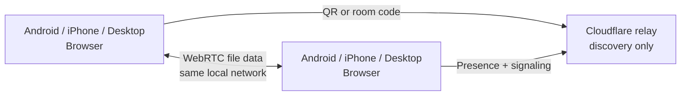

# AirLocal

<p align="center">
  <strong>AirDrop for Android and every device.</strong><br />
  Share files privately in your browser over Wi-Fi, a phone hotspot, or LAN.
</p>

<p align="center">
  <a href="https://github.com/pulkitpareek18/AirLocal">
    
  </a>
  <a href="https://github.com/pulkitpareek18/AirLocal/network/members">
    
  </a>
  <a href="https://github.com/pulkitpareek18/AirLocal/blob/main/LICENSE">
    
  </a>
</p>

<p align="center">
  <a href="#why-airlocal">Why AirLocal</a> ·
  <a href="#how-it-works">How it works</a> ·
  <a href="#run-it-yourself">Run it yourself</a> ·
  <a href="#privacy-model">Privacy</a>
</p>

## The problem

Moving a file between Android, iPhone, Mac, Windows, and Linux should not
require an account, a cable, a messaging app, or a third-party upload service.
AirLocal gives every modern browser a simple local file-sharing workflow.

## Why AirLocal

- **AirDrop-style, without Apple-only hardware** — Android, iPhone, Mac,
  Windows, and Linux can share through a browser.
- **No account and no app install** — open the site and pair.
- **Local-first transfer** — keep both devices on the same Wi-Fi, phone
  hotspot, or LAN/Ethernet network.
- **Your files do not go to the relay** — WebRTC carries file data directly
  between the browsers.
- **QR pairing in seconds** — scan the QR code with a phone camera.
- **Room-code pairing when you need it** — use a shared four-digit code.
- **Built for real transfers** — queues, progress, speed, cancellation,
  backpressure, and large-file staging.
- **Control where received files go** — Downloads fallback, selected folders,
  organization by file type, duplicate handling, and optional backup folders.

> **Important:** Both devices must be on the same local network. Use shared
> Wi-Fi, a phone hotspot, or a LAN/Ethernet connection. If the devices are on
> different networks, AirLocal will not transfer files. File transfer never
> uses mobile data.

## How it works



1. Open AirLocal on both devices.
2. Connect both devices to the same local network.
3. Scan the QR code, or enter the same four-digit room code.
4. Accept the connection request.
5. Select files and transfer them directly to the other browser.

The Cloudflare Worker helps devices find each other and negotiates the
connection. It does not receive or store the file bytes. Once the browser
connection is established, the transfer uses the local network.

## What is included

### Pairing

- QR links with device-specific pairing information
- Four-digit room codes
- Nearby-device discovery
- Reconnect and stale-session handling
- Device names and platform indicators

### Transfers

- Multi-file queue
- Chunked streaming through four unordered data channels
- Transfer progress, speed, and estimated time remaining
- Sender and receiver cancellation
- Backpressure for stable memory usage
- OPFS staging for large received files
- Browser Downloads fallback

### File management

- Select a destination folder where supported
- Organize files into Images, Videos, Audio, Documents, Presentations,
  Archives, and Other
- Replace, Keep both, Skip, and Replace all conflict actions
- Backup mode with configurable date and time tokens
- Permission-aware fallback when custom folders are unavailable

## Run it yourself

### Requirements

- Node.js 18 or newer
- npm
- A modern browser with WebRTC, WebSockets, HTTPS, and OPFS support
- A deployed relay for multi-device discovery

### Frontend

```bash
git clone https://github.com/pulkitpareek18/AirLocal.git
cd AirLocal
npm install
npm run dev
```

Available commands:

```bash
npm run dev       # Start the Vite development server
npm run check     # Type-check the frontend and validate the Worker syntax
npm run build     # Build the production frontend into dist/
```

### Relay

The relay is a Cloudflare Worker with a Durable Object room for presence and
signaling:

```bash
cd worker
npx wrangler login
npx wrangler deploy
```

The deployment configuration is in
[worker/wrangler.toml](./worker/wrangler.toml). After deployment, set the
Worker URL in `RELAY_DEFAULT` in [src/airlocal.ts](./src/airlocal.ts).

For local testing, the relay can also be overridden in the browser:

```js
localStorage.setItem(
  'airlocal.relay.v1',
  'wss://your-worker.workers.dev'
);
```

### Vercel

The frontend is a static Vite build and can be deployed to Vercel:

```bash
npm run check
npm run build
npx vercel --prod
```

[vercel.json](./vercel.json) configures the build command and `dist` output
directory. Add a custom domain from the Vercel project settings. A `js.org`
subdomain is configured through the js.org CNAME mapping process.

### GitHub Pages

GitHub Pages deployment is configured in
`.github/workflows/deploy-pages.yml`. Every push to `main` runs the project
checks, builds the Vite frontend, preserves the hash-based application routes,
and publishes the `dist/` directory through GitHub Pages.

The expected project URL is:

```text
https://pulkitpareek18.github.io/AirLocal/
```

To enable it manually, open the repository's **Settings → Pages** and select
**GitHub Actions** as the source. The workflow then deploys automatically on
future pushes to `main`.

## Privacy model

- File bytes are transferred by WebRTC between the connected browsers.
- Vercel does not receive file contents.
- The Cloudflare relay handles presence, signaling, and limited control
  messages only.
- Same-network transfers use the local Wi-Fi, hotspot, or LAN/Ethernet path.
- Room codes identify a discovery room; they are not passwords.
- Anyone who knows a room code may see devices in that room. Use a fresh code
  for sensitive sharing.
- WebRTC provides the encrypted browser transport used for the connection.

The privacy properties also depend on the browser, operating system, network,
and relay deployment you use. Review those environments before transferring
sensitive data.

## Save locations and backup mode

Received files use the browser's Downloads folder by default. On browsers that
support the File System Access API, a receiver can grant access to a selected
folder.

After permission is granted, AirLocal can:

- Organize files by type
- Create a new timestamped folder for each connection
- Use configurable tokens such as `{date}`, `{time}`, `{year}`, `{month}`,
  `{day}`, `{hour}`, `{minute}`, and `{second}`
- Handle duplicate names with Replace, Keep both, Skip, or Replace all

Backup mode is disabled when Browser Downloads is active because creating
backup folders requires permission to write to a selected folder.

## Browser support and limits

AirLocal requires HTTPS in production, WebRTC, WebSockets, and OPFS. Private
browsing, managed browsers, and some mobile browser configurations may disable
OPFS or the File System Access API. AirLocal falls back to browser Downloads
where possible.

The application asks for confirmation before unusually large operations:

- More than 100 files
- More than 25 GB total
- A file larger than 10 GB

These are confirmation thresholds, not guaranteed transfer limits. Actual
limits depend on available storage, browser behavior, device resources, and
network conditions.

## Project structure

```text
.
├── src/
│   ├── App.tsx              # React composition root
│   ├── AppContent.tsx       # Interface and information pages
│   ├── airlocal.ts          # Pairing and transfer engine
│   ├── components/ui/       # Local shadcn-style primitives
│   ├── custom.css           # Design tokens and application styles
│   └── main.tsx             # Vite entry point
├── worker/
│   ├── worker.js            # Cloudflare Worker + Durable Object relay
│   └── wrangler.toml        # Worker deployment configuration
├── index.html               # Vite document shell
├── vercel.json              # Vercel configuration
├── package.json             # Scripts and dependencies
└── vite.config.ts           # Vite configuration
```

## Production checklist

- [ ] Deploy the Cloudflare Worker and verify its health endpoint.
- [ ] Run `npm run check` and `npm run build`.
- [ ] Deploy the frontend over HTTPS.
- [ ] Test QR and room-code pairing.
- [ ] Test shared Wi-Fi, phone-hotspot, and LAN/Ethernet connections.
- [ ] Test a large file and a multi-file queue.
- [ ] Test cancellation from both sides.
- [ ] Test duplicate handling and Downloads fallback.
- [ ] Use a fresh room code for sensitive sharing sessions.

## Contributing

Issues and pull requests are welcome. For a focused change:

1. Fork the repository.
2. Create a branch.
3. Make the smallest complete change.
4. Run `npm run check`, `npm run build`, and `git diff --check`.
5. Include the user-visible behavior and validation steps in the pull request.

Do not commit credentials, local environment files, or generated build output.

## References

The application includes a citations page covering WebRTC, RTCDataChannel,
ICE, STUN, WebSockets, File System APIs, OPFS, IndexedDB, Web Crypto, QR
generation, Cloudflare Durable Objects, Lucide, Tailwind CSS, and Vercel.

## License

AirLocal is licensed under the [MIT License](./LICENSE).

## Maintainer

[Pulkit Pareek](https://github.com/pulkitpareek18)
